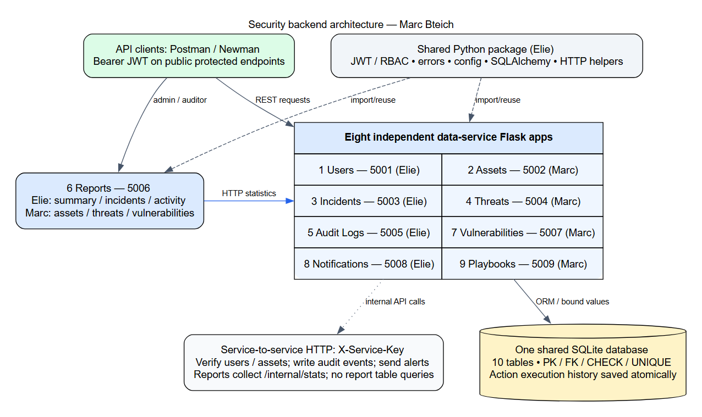
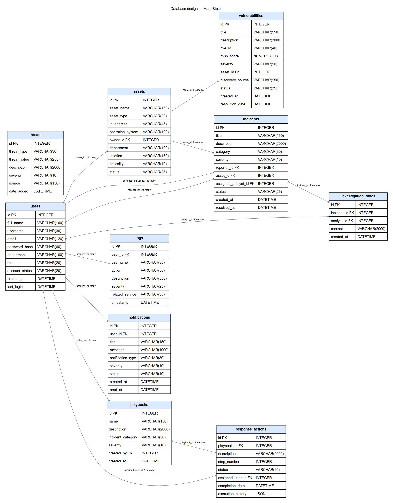

# Person B report draft (Marc Bteich)

Security Incident Detection and Response Management System — Sprint 1. Team: Elie Medawar and Marc Bteich. Prepared from the implemented backend and actual local tests on 20 October 2026. These are Marc’s assigned sections, to review and combine with Elie’s title page, contents, validation, authentication, GitHub sections and evidence. No claim is made that this draft has been personally reviewed or accepted by the instructor.

## 3. Introduction (Marc Bteich)

The system provides a backend for recording and investigating security incidents, identifying affected organizational assets, maintaining threat indicators, tracking vulnerabilities and following response procedures. A central record of users, incidents, assets, audit events and notifications supports coordinated security work. This sprint implements REST endpoints, persistent storage, authentication, role-based permissions, validation and reproducible API tests; a frontend is outside the professor’s required scope.

The objectives are to separate responsibilities into independent services, preserve relationships through database constraints, restrict operations to authorized roles, record security-relevant changes and produce statistics from service APIs. Marc owns Assets, Threat Intelligence, Vulnerabilities, Playbooks/Actions, three reports, the shared schema/sample data and documentation integration. Elie owns Users, Incidents, Audit Logs, Notifications, the shared foundation and the other three reports.

## 4. System Architecture (Marc Bteich)

Nine Flask applications run independently on ports 5001–5009. They share one SQLite database and common Python infrastructure. Each service uses model classes for persistence, a service/validator layer for business rules and thin routes for authorization and responses. SQLAlchemy binds values rather than concatenating client input into SQL. SQLite development is permitted by the team plan; MySQL execution has not been verified.

Public requests carry Bearer JWTs containing user_id, username, role and expiry. Shared role checks distinguish admin, analyst, user and auditor. Internal HTTP requests carry X-Service-Key. Assets verifies owners through Users; Incidents and Vulnerabilities verify assets through Assets; Playbooks verifies assigned users through Users. Every successful mutation requests an audit event. Critical threat/vulnerability creation identifies all admins through Users and requests notifications through Notifications.

The Reports app registers both owners’ blueprints. It calls source /internal/stats endpoints through the existing get_service/ReportBuilder helpers and does not read source tables for report calculations. A missing required source yields 503. Logs and Notifications use the shared best-effort HTTP clients; normal writes can succeed if these recipients are unavailable. Playbook deletion is stricter: execution-history events must be acknowledged by Logs before actions can be cascaded away.

## 5. Implementation Details (Marc Bteich)

### Assets (Marc Bteich)

AssetValidator validates required strings, type, IP, owner ID, criticality and status. AssetService normalizes IPv4/IPv6, verifies the owner over HTTP and performs ORM writes and queries. Admins write; admins/auditors list; analysts can retrieve/search. Search filters combine with AND and escape LIKE wildcards. Incidents survive asset deletion with a null asset link; existing vulnerabilities block deletion with 409. The original Assets behavior is retained.

### Threat Intelligence (Marc Bteich)

ThreatValidator canonicalizes IP addresses, domains (lowercase and no terminal dot), and hexadecimal hashes. Hash lengths identify MD5/SHA1/SHA256 formats; malware-signature/Other values must be nonempty strings. A unique constraint on threat_type/threat_value protects against duplicates including concurrent inserts. Admins write; analysts read/search; auditors read lists/details. The detailed Service 4 matrix is followed for auditor search, and the existing shared enum uses Other.

### Vulnerability Management (Marc Bteich)

VulnerabilityValidator checks required fields, a CVE-YYYY-NNNN+ identifier, finite numeric CVSS 0–10 and a real asset. Only admins create/delete, while analysts may update. Status advances one step at a time through Open, Under Investigation, In Progress, Resolved and Closed. The server records resolution_date on Resolved. Invalid transitions are rejected before applying any field changes, so a rejected update cannot partially save a description.

### Playbooks and Response Actions (Marc Bteich)

Playbooks organize response procedures by incident category and severity. Actions have unique positive step numbers within each playbook and are returned in order. Admins manage playbooks; admins/analysts add and progress actions. Pending advances to In Progress and then Completed; execution requires an active assigned user. completion_date is generated automatically. An append-only JSON execution_history field records actor, timestamp, prior/next status, assignment and completion. The JSON list is saved in the same transaction as the action. Before deletion, history is archived through Logs; a failed archive returns 503 and preserves the playbook. Deletion cascades to actions only after archival.

### Reports and service communication (Marc Bteich)

The asset report returns total/critical assets and counts by type; the threat report returns total, counts by severity/type and the latest five records; the vulnerability report returns total/critical vulnerabilities and counts by severity/status. Source services calculate grouped counts with ORM aggregate queries. Admins and auditors may generate reports; analysts and regular users receive 403. Elie’s summary/incidents/activity routes are integrated unchanged.

## 6. Database Design (Marc Bteich)

The schema contains exactly ten tables with integer primary keys. Foreign keys enforce ownership, reporting/assignment, affected assets, notes, notifications and response actions. Enum CHECK constraints restrict known roles, statuses, categories and severities; UNIQUE constraints protect usernames/emails, threat indicator pairs and playbook step numbers. CVSS and action-step bounds are checked by the database. IP/CVE formats and status transitions are validated by services because a membership CHECK cannot express an ordered lifecycle.

Users→Assets is one-to-many through owner_id; Users→Incidents uses reporter_id and optional assigned_analyst_id; Assets→Incidents and Assets→Vulnerabilities identify affected resources; Incidents→Investigation Notes is one-to-many; Users→Logs/Notifications identifies actors and recipients; Users→Playbooks identifies creators; Playbooks→Response Actions is ordered one-to-many; Users→Response Actions identifies assignees. Departments are fields rather than an extra table, preserving the agreed ten-table design.

Deletion choices preserve useful records: incident asset/analyst links and log user links become null; log usernames remain as snapshots; incident notes and user notifications cascade with their parents; an asset owner and a vulnerable asset cannot be deleted while required references exist. Playbook actions cascade after their execution history is archived. Action-history schema migration adds one column to an existing table without dropping data. All ten ORM column definitions were compared with schema.sql.

### Tables and field definitions (Marc Bteich)

#### assets (Marc Bteich)

| Field | Type | Constraint / relationship |

|---|---|---|

| id | INTEGER | PK |

| asset_name | VARCHAR(150) | NOT NULL |

| asset_type | VARCHAR(30) | NOT NULL |

| ip_address | VARCHAR(45) | NOT NULL |

| operating_system | VARCHAR(100) | nullable |

| owner_id | INTEGER | NOT NULL; FK → users.id; delete NO ACTION |

| department | VARCHAR(100) | NOT NULL |

| location | VARCHAR(150) | nullable |

| criticality | VARCHAR(10) | NOT NULL |

| status | VARCHAR(25) | NOT NULL |

#### incidents (Marc Bteich)

| Field | Type | Constraint / relationship |

|---|---|---|

| id | INTEGER | PK |

| title | VARCHAR(150) | NOT NULL |

| description | VARCHAR(2000) | NOT NULL |

| category | VARCHAR(30) | NOT NULL |

| severity | VARCHAR(10) | NOT NULL |

| reporter_id | INTEGER | NOT NULL; FK → users.id; delete NO ACTION |

| asset_id | INTEGER | nullable; FK → assets.id; delete SET NULL |

| assigned_analyst_id | INTEGER | nullable; FK → users.id; delete SET NULL |

| status | VARCHAR(25) | NOT NULL |

| created_at | DATETIME | NOT NULL |

| resolved_at | DATETIME | nullable |

#### investigation_notes (Marc Bteich)

| Field | Type | Constraint / relationship |

|---|---|---|

| id | INTEGER | PK |

| incident_id | INTEGER | NOT NULL; FK → incidents.id; delete CASCADE |

| analyst_id | INTEGER | nullable; FK → users.id; delete SET NULL |

| content | VARCHAR(2000) | NOT NULL |

| created_at | DATETIME | NOT NULL |

#### logs (Marc Bteich)

| Field | Type | Constraint / relationship |

|---|---|---|

| id | INTEGER | PK |

| user_id | INTEGER | nullable; FK → users.id; delete SET NULL |

| username | VARCHAR(30) | nullable |

| action | VARCHAR(50) | NOT NULL |

| description | VARCHAR(500) | NOT NULL |

| severity | VARCHAR(20) | NOT NULL |

| related_service | VARCHAR(30) | NOT NULL |

| timestamp | DATETIME | NOT NULL |

#### notifications (Marc Bteich)

| Field | Type | Constraint / relationship |

|---|---|---|

| id | INTEGER | PK |

| user_id | INTEGER | NOT NULL; FK → users.id; delete CASCADE |

| title | VARCHAR(150) | NOT NULL |

| message | VARCHAR(1000) | NOT NULL |

| notification_type | VARCHAR(30) | NOT NULL |

| severity | VARCHAR(10) | NOT NULL |

| status | VARCHAR(10) | NOT NULL |

| created_at | DATETIME | NOT NULL |

| read_at | DATETIME | nullable |

#### playbooks (Marc Bteich)

| Field | Type | Constraint / relationship |

|---|---|---|

| id | INTEGER | PK |

| name | VARCHAR(150) | NOT NULL |

| description | VARCHAR(2000) | NOT NULL |

| incident_category | VARCHAR(30) | NOT NULL |

| severity | VARCHAR(10) | NOT NULL |

| created_by | INTEGER | NOT NULL; FK → users.id; delete NO ACTION |

| created_at | DATETIME | NOT NULL |

#### response_actions (Marc Bteich)

| Field | Type | Constraint / relationship |

|---|---|---|

| id | INTEGER | PK |

| playbook_id | INTEGER | NOT NULL; FK → playbooks.id; delete CASCADE |

| description | VARCHAR(2000) | NOT NULL |

| step_number | INTEGER | NOT NULL |

| status | VARCHAR(20) | NOT NULL |

| assigned_user_id | INTEGER | nullable; FK → users.id; delete SET NULL |

| completion_date | DATETIME | nullable |

| execution_history | JSON | NOT NULL; SQL default '[]' |

#### threats (Marc Bteich)

| Field | Type | Constraint / relationship |

|---|---|---|

| id | INTEGER | PK |

| threat_type | VARCHAR(30) | NOT NULL |

| threat_value | VARCHAR(255) | NOT NULL |

| description | VARCHAR(2000) | NOT NULL |

| severity | VARCHAR(10) | NOT NULL |

| source | VARCHAR(150) | NOT NULL |

| date_added | DATETIME | NOT NULL |

#### users (Marc Bteich)

| Field | Type | Constraint / relationship |

|---|---|---|

| id | INTEGER | PK |

| full_name | VARCHAR(100) | NOT NULL |

| username | VARCHAR(30) | NOT NULL |

| email | VARCHAR(120) | NOT NULL |

| password_hash | VARCHAR(60) | NOT NULL |

| department | VARCHAR(100) | NOT NULL |

| role | VARCHAR(20) | NOT NULL |

| account_status | VARCHAR(20) | NOT NULL |

| created_at | DATETIME | NOT NULL |

| last_login | DATETIME | nullable |

#### vulnerabilities (Marc Bteich)

| Field | Type | Constraint / relationship |

|---|---|---|

| id | INTEGER | PK |

| title | VARCHAR(150) | NOT NULL |

| description | VARCHAR(2000) | NOT NULL |

| cve_id | VARCHAR(40) | NOT NULL |

| cvss_score | NUMERIC(3,1) | NOT NULL |

| severity | VARCHAR(10) | NOT NULL |

| asset_id | INTEGER | NOT NULL; FK → assets.id; delete NO ACTION |

| discovery_source | VARCHAR(150) | NOT NULL |

| status | VARCHAR(25) | NOT NULL |

| created_at | DATETIME | NOT NULL |

| resolution_date | DATETIME | nullable |

### Sample data and design decisions (Marc Bteich)

database.seed is additive and idempotent. It creates synthetic lab scenarios spanning all roles, account statuses, asset types/statuses, threat types/severities, incident/vulnerability lifecycles, notification types/read states and action statuses. Passwords are generated randomly, hashed with the existing User method and stored privately in .local/seed-credentials.json for local test access. No existing password is reset. Seeded lifecycle states/history are explicitly labelled scenario snapshots; HTTP tests separately demonstrate real transitions.

## 8. API Documentation (Marc Bteich)

The merged endpoint reference is API_DOCUMENTATION.md. SIDRMS.postman_collection.json combines both students’ requests without altering Elie’s source collections or scripts; collection-level hooks are preserved as folder hooks. Marc’s individual collections exercise positive and negative cases and automatically create/clean relationship fixtures. Actual Newman results and redacted request/response records are in evidence/.

## 11. References and AI-use Disclosure (Marc Bteich)

Professor’s Sprint1-Brief.docx; team PLAN.md and PROMPT_PERSON_B.md (kept outside Git). Flask documentation: https://flask.palletsprojects.com/en/stable/ . SQLAlchemy cascades: https://docs.sqlalchemy.org/en/20/orm/cascades.html . Python ipaddress: https://docs.python.org/3/library/ipaddress.html . Postman Newman: https://learning.postman.com/docs/reference/newman-cli/command-line-integration-with-newman/ . Accessed 20 October 2026.

AI-use disclosure for Marc to review: OpenAI Codex assisted with interpreting the team contract, implementing Person B services and database scripts, writing/running automated and Newman tests, debugging integration, and preparing diagrams/documentation/evidence reports. Generated code and prose require Marc’s personal review, adaptation and understanding. Execution results come from actual local runs; synthetic seed data is labelled. No screenshots are represented as a Postman GUI session when they are browser captures of Newman execution reports.

## Appendix: Evidence and submission review (Marc Bteich)

Review evidence/index.html, the PNG execution-report captures, database-inspection output and SCREENSHOT_CHECKLIST.md. The DOCX draft embeds selected genuine report screenshots. If the instructor requires the Postman desktop interface specifically, repeat those cases in Postman and replace/add GUI screenshots; Newman CLI results are clearly labelled. Combine these sections with Elie’s report and regenerate the common contents/page numbers. Both students must attend CREATES at least three days before the deadline, disclose AI assistance and personally upload the agreed final package after review.
